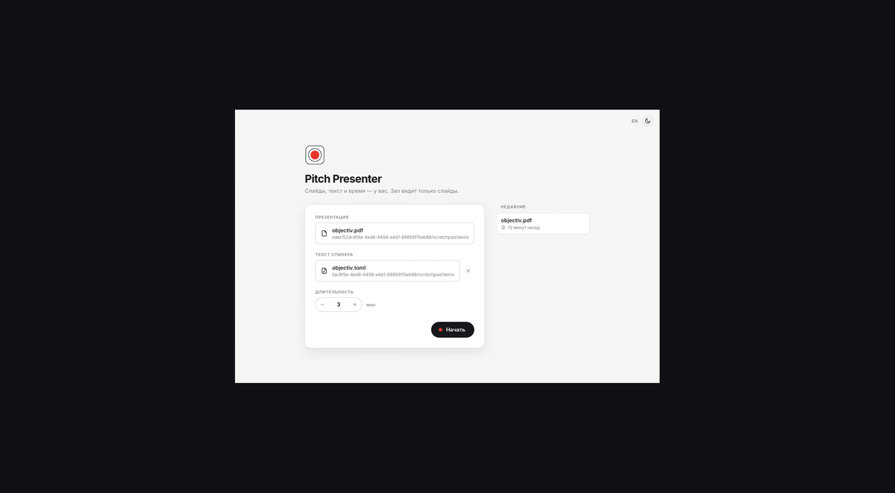
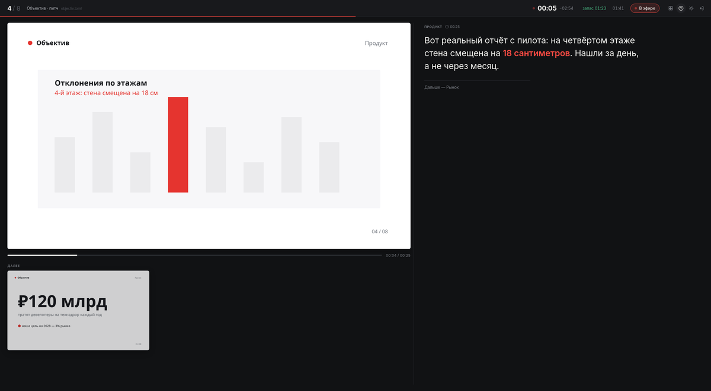

<p align="center">
  
</p>

<h1 align="center">Pitch Presenter</h1>

<p align="center">
  A presenter view that stays out of your way.<br>
  Slides, notes and time for you. The audience sees only the slides.
</p>

<p align="center">
  <a href="https://github.com/semao0/pitch-presenter/releases/latest"><b>Download</b></a>
  &nbsp;·&nbsp; macOS &nbsp;·&nbsp; Windows &nbsp;·&nbsp; Linux
  &nbsp;·&nbsp; <a href="README.md">Русский</a>
</p>

<p align="center">
  
</p>

## Why

**Your text in front of you.** Large, with key words highlighted and remarks to yourself. Edit the
file and the notes update right during rehearsal.

**Time under control.** Not just a stopwatch: every slide has its own limit, and the header shows
whether you are ahead of or behind the plan. Without limits, time is split by the amount of text.

**The audience sees only the slides.** Plug in a projector and the audience window opens on it in
fullscreen by itself. Navigate from either window, with clicks or a clicker.

PDF opens directly; PowerPoint, Keynote and ODP go through LibreOffice. Light and dark themes,
English and Russian interface.

<p align="center">
  
</p>

## Speaker notes

Put `talk.toml` next to `talk.pdf` and it is picked up automatically.

```toml
minutes = 5                 # talk length

[[slide]]
n = 1
title = "The pain"
time = "0:30"               # limit for this slide
text = '''
Is what happens on site what **should** happen according to the plan?

> pause — a remark to yourself
'''
```

`**bold**` · `*italic*` · `==highlight==` · `- lists` · `> remarks` · `reserve = true` — a slide you
may skip. Full example: [example.toml](example.toml).

## Keys

| | |
|---|---|
| `→` `Space` · click | next |
| `←` · right click | back |
| `12` `Enter` | go to slide 12 |
| `G` | all slides |
| `B` | black screen |
| `T` · `Shift R` | timer: pause · reset |
| `+` `−` | text size |
| `A` | audience window |
| `?` | all shortcuts |

## Install

| | |
|---|---|
| **macOS** | `.dmg` for Apple Silicon and Intel. On first launch: right click → Open |
| **Windows** | `.exe` or `.msi` |
| **Linux** | `.deb`, `.rpm` or `.AppImage` for x64 and ARM64 |

Everything is in [Releases](https://github.com/semao0/pitch-presenter/releases/latest).
